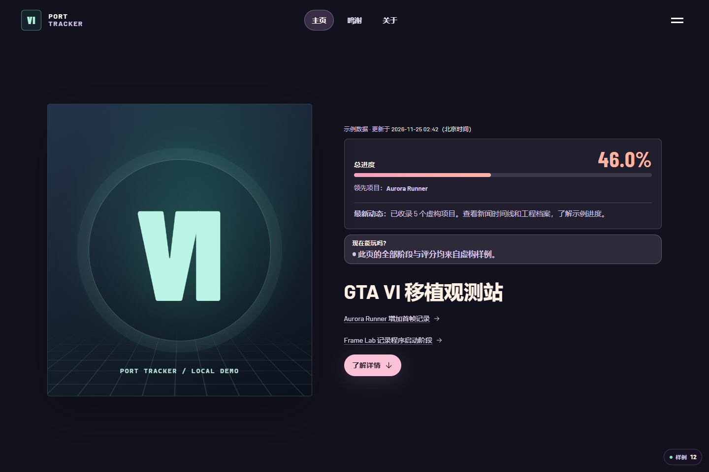

# GTA VI PC 移植观测站

以新闻时间线、进度里程碑和工程档案呈现 GTA VI PC 移植社区动态。此仓库包含站点前端、Node.js API、内容与账号存储，以及管理控制台。初次运行会载入虚构项目和样例公告。



## 公开仓库与协作

本公开源码仓库位于 [YunxiRamito/GTA6PC-PortTracker](https://github.com/YunxiRamito/GTA6PC-PortTracker)。它保留可独立运行的通用网站逻辑、Node.js API、存储接口骨架和管理控制台示例；仓库内的项目、新闻、账号和访问统计都是虚构或空壳数据。

发布前审计明确排除了：用户数据库、生产账号与会话、运行目录、弹幕/反馈/鸣谢运行数据、环境文件、私钥、令牌、生产域名凭据、部署配置、浏览器 profile、`.preview/` 与日志，以及原站封面图、原始图片和音频。`docs/demo-screenshot.png` 是脱敏演示截图，封面使用 CSS 绘制。

希望同步维护站点时，先阅读 [同步与审阅流程](docs/sync.md)，运行 `tools/sync-from-site.cjs --review`，逐项检查候选差异和敏感内容，再运行测试和 `tools/check-release.js`。功能改动请使用独立分支提交 Pull Request；审阅通过后再合并，生产站点不会由本仓库的 CI 自动发布。

## 启动网站与控制台

需要 Node.js 18 或更新版本。使用 Node.js 标准库，直接从仓库根目录启动。

```sh
node server.js
```

浏览器打开 **http://127.0.0.1:8787/**。站点将本机产生的运行记录保存到 `.runtime/`。`PORT` 可指定本地端口，`GTAVI_RUNTIME_DIR` 可指定独立的运行目录。

使用控制台前，先停止服务并在终端创建一个本地站长账号。命令会提示输入密码，并将凭据的派生值写入新建的本地账号存储。

```sh
node scripts/bootstrap-account-owner.js local-owner
node server.js
```

打开 **http://127.0.0.1:8787/admin/**，使用刚创建的账号登录。控制台可编辑内容、查看反馈并回复、管理弹幕词条与禁言，以及维护鸣谢名单。账号注册、角色检查和会话由同源 API 处理。

## 运行截图演示

```sh
node preview.js
```

演示提供固定的虚构档案、新闻、鸣谢名单和访问趋势，从内存返回数据。服务与控制台模式共用页面样式。一次运行一个入口，或用 `PORT` 为两者分配不同端口。

公开页面可在顶栏切换简体中文、English 和日本語。两个入口的内容、工程档案与 RSS 同时支持 `?lang=en` 和 `?lang=ja`。静态文案和内容译文的更新步骤见[三语维护说明](docs/localization.md)。

## 代码和接口

| 入口 | 用途 |
| --- | --- |
| `index.html`、`app.js`、`assets/` | 首页、新闻、工程卡片、进度与交互 |
| `about.html`、`thanks.html`、`feedback.html` | 关于、鸣谢和反馈页面 |
| `server.js`、`api/` | HTTP 路由、内容验证、持久化与权限检查 |
| `admin/` | 管理控制台、登录与账号管理 |
| `fixtures/demo.js` | 项目、新闻和统计样例 |
| `tools/sync-from-site.cjs` | 经审阅更新前端与后端源码 |

| 路径 | 主要用途 |
| --- | --- |
| `GET /api/content`、`GET /api/dashboard`、`GET /rss.xml` | 公开内容、汇总和新闻订阅 |
| `GET /api/traffic`、`GET /api/traffic/history` | 本地在线统计和趋势 |
| `POST /api/danmaku`、`GET /api/danmaku/events` | 消息提交与 SSE，提交前从 `/api/danmaku/nonce` 获取一次性凭据 |
| `POST /api/feedback`、`GET /api/feedback/replies` | 浏览器反馈和回复，使用 `X-Feedback-Client` 关联 |
| `GET /api/sponsors`、`GET /api/site-notices` | 公开鸣谢与站点通知 |
| `GET /api/admin/content/:section`、`PUT /api/admin/content/:section` | 站长与管理员可维护分区，写入时携带读取响应中的 `ETag` 作为 `If-Match` |
| `/api/admin/session`、`/api/admin/accounts`、`/api/admin/danmaku/*` | 登录会话、账号管理与按角色授权的弹幕管理 |

### 无公开仓库地址的进度记录

可在路线 JSON 或 `PUT /api/admin/content/roadmap` 中维护可选的 `roadmap.privateRepositories` 数组（最多 160 条）。每条包含 `id`、`title`、`summary`、`sourceLabel`、`sourceUrl` 和 `portProgress`，不填 `repo`。`id` 在数组内唯一，使用 1–48 个小写英文字母、数字和分隔用的连字符，例如 `sample-launch`。

`GET /api/dashboard` 单独返回 `privateRepositories`，并为 `id` 添加 `private-repo-` 前缀。条目使用公版原有评分器参与总进度和工程档案排序，不进入 `projects`、GitHub 查询或 GitHub 统计。

「私有仓库」表示仓库本身没有公开地址，**记录仍从公开 API 和页面展示**。`sourceUrl` 只能使用可公开分享的 HTTPS 证据链接或页内锚点；不要填写私库地址、内网链接或含访问凭据的 URL。随代码分发的两条演示记录均为虚构，仅链接到页内说明。

同步方法、源文件范围和审阅步骤见 [docs/sync.md](docs/sync.md)。候选先写入 `.preview/public-source-review/`，核对后才可按本轮摘要应用；不递归复制源站。

默认使用本地 GitHub 指标样例。录入公开仓库后，可用 `GTAVI_GITHUB_REFRESH=1` 启用公开 GitHub API 指标刷新。`GTAVI_GITHUB_TOKEN` 用于需要认证的刷新请求。

```sh
node --test
node tools/check-release.js
```

## 评分与第三方组件

本站使用 Portwatch VI 的进度评分方法，包括七级里程碑、基础准备权重、阶段内插值，以及进入游戏后的帧率和稳定性计分。`assets/port-score.js` 是按这一方法为公开仓库重新编写的实现，保留了本站的中文阶段、并列顺序和汇总字段。[Portwatch VI](https://github.com/4lwayz/portwatch-vi) · [固定修订的评分方法](https://github.com/4lwayz/portwatch-vi/blob/98f78dde8ed87ccb9bb67588e160d1aab7ca814d/assets/js/scoring.js)

字体、滚动和图标分别使用 Barlow、Lenis、Microsoft Fluent UI System Icons 与 Primer Octicons。版本、来源和许可正文见[来源与许可清单](docs/provenance.md)。

本站为独立社区项目，与 Rockstar Games 无关联。
